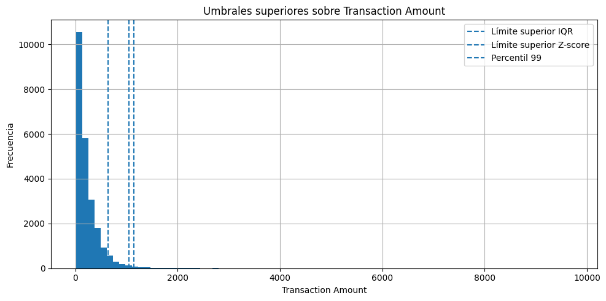
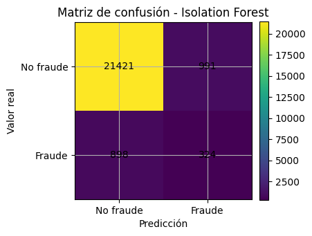
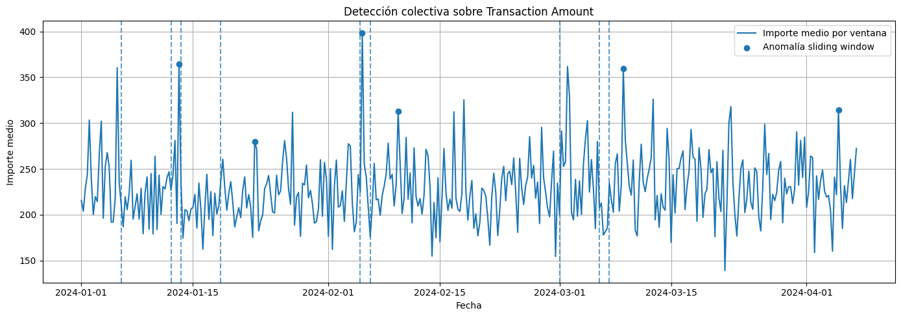

# Detección de fraude en e-commerce mediante detección de anomalías


Detección **no supervisada** de transacciones fraudulentas en comercio electrónico,
abordada desde tres niveles complementarios: anomalías **puntuales**, **contextuales** y
**colectivas**. La etiqueta `Is Fraudulent` se usa **solo para evaluar**, nunca para
entrenar, que es la situación habitual cuando no se dispone de fraude etiquetado.

- **Entrenamiento:** muestra reproducible del 10 % del primer fichero (147.295 transacciones,
  5,0 % fraudulentas).
- **Evaluación:** segundo fichero completo (23.634 transacciones, 5,2 % fraudulentas).

## Ingeniería de variables

| Variable | Señal que aporta |
|---|---|
| `log_amount`, `amount_per_item` | Importe con menos influencia de extremos; importe por unidad |
| `amount_ratio_*` | Importe frente a la mediana de su categoría, método de pago, dispositivo y hora: detecta importes **inusuales en su contexto** |
| `address_mismatch` | Dirección de envío distinta de la de facturación (sin usar direcciones de alta cardinalidad) |
| `dayofweek`, `is_weekend`, `is_night` | Patrones temporales |

Pipeline de `scikit-learn`: imputación por mediana y estandarización para las variables
numéricas; imputación por moda y *one-hot encoding* para las categóricas de baja cardinalidad.

## Resultados en el conjunto de evaluación

Con una prevalencia de fraude del 5,2 %, el F1 de la clase fraudulenta es la métrica de
referencia (la exactitud es engañosa: no detectar nada ya da un 94,8 %).

| Nivel | Método | Precision fraude | Recall fraude | F1 fraude |
|---|---|---:|---:|---:|
| Contextual | **Isolation Forest** | 24,6 % | 26,5 % | **25,5 %** |
| Puntual | Z-score \|z\| > 3 | 57,5 % | 16,0 % | 25,1 % |
| Puntual | MAD \|z_mod\| > 3,5 | 24,9 % | 24,8 % | 24,9 % |
| Puntual | IQR 1,5 | 23,2 % | 25,5 % | 24,3 % |
| Contextual | One-Class SVM | 19,0 % | 26,9 % | 22,3 % |
| Contextual | Local Outlier Factor | 20,6 % | 23,8 % | 22,1 % |
| Puntual | Percentiles 1–99 | 35,3 % | 14,6 % | 20,6 % |

- **Isolation Forest** obtiene el mejor equilibrio: sus alertas son fraude con una frecuencia
  unas **4,8 veces mayor que la tasa base** del 5,2 %.
- El **Z-score** sobre el importe es muy preciso (57,5 %), pero solo detecta el 16 % del
  fraude: los importes extremos son una señal fiable, aunque la mayoría del fraude no tiene
  importes atípicos.

| Umbrales sobre el importe | Matriz de confusión (Isolation Forest) |
|---|---|
|  |  |

### Anomalías colectivas

Sobre la serie del importe medio en ventanas de 6 horas (390 ventanas) se aplican una
**ventana deslizante con z-score** y detección de **puntos de cambio con PELT**
(`ruptures`). Las 6 ventanas anómalas presentan tasas de fraude del 7,8 % al 11,9 %, frente
al 5 % medio.



## Conclusión

Ningún método aislado basta. Una estrategia en producción combinaría los tres niveles:

1. **Reglas estadísticas** sobre el importe para generar alertas inmediatas con alta precisión.
2. **Isolation Forest** para priorizar transacciones sospechosas.
3. **Análisis temporal** para detectar campañas o cambios de patrón.

## Datos y ejecución

Datos: [Fraudulent E-Commerce Transactions](https://www.kaggle.com/datasets/shriyashjagtap/fraudulent-e-commerce-transactions)
(Kaggle, sintéticos). Coloca `Fraudulent_E-Commerce_Transaction_Data.csv` y
`Fraudulent_E-Commerce_Transaction_Data_2.csv` en `data/`.

```bash
pip install -r requirements.txt
jupyter notebook fraud_anomaly_detection.ipynb
```
